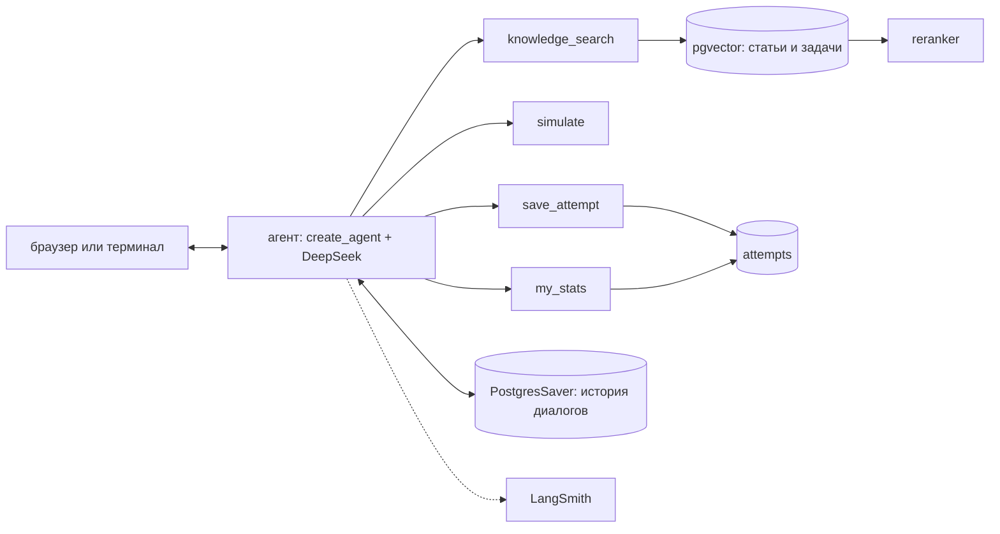
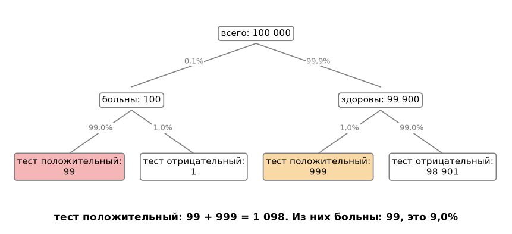
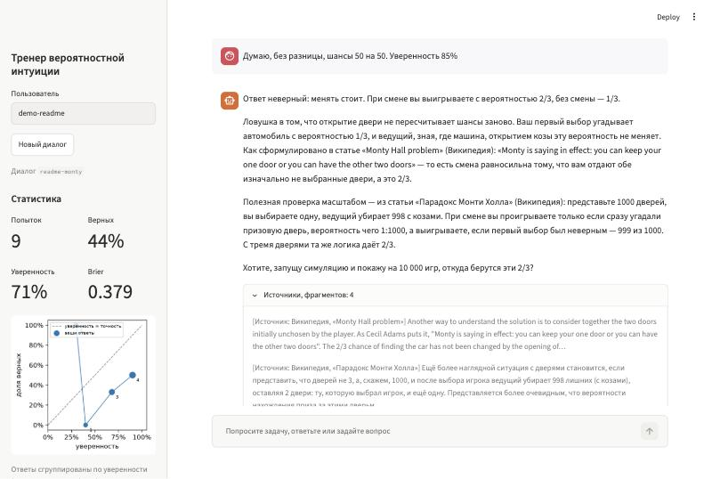
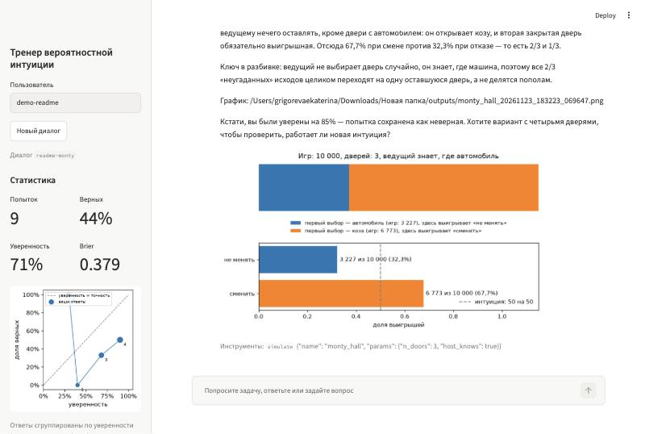
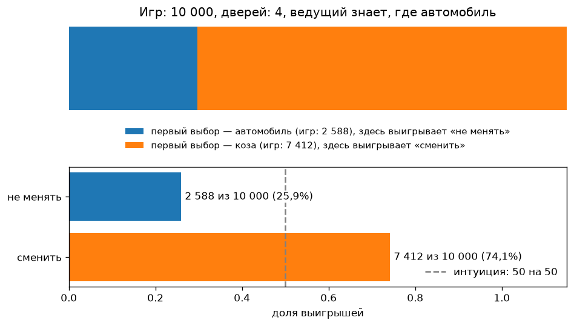
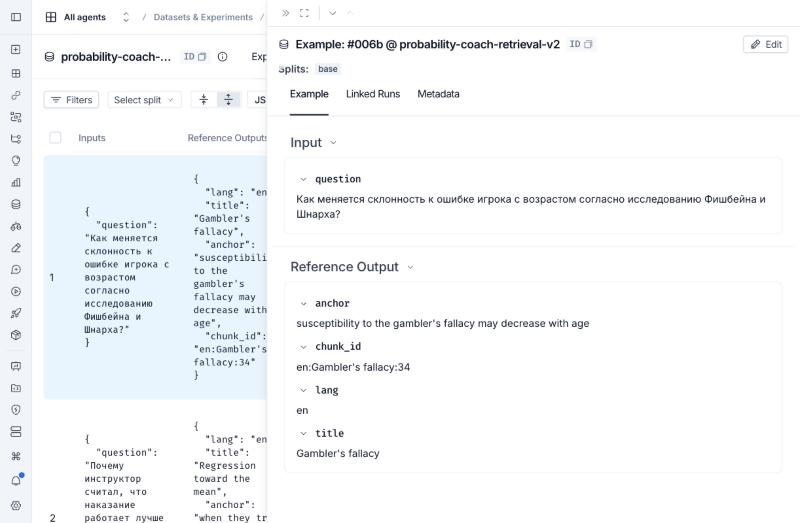
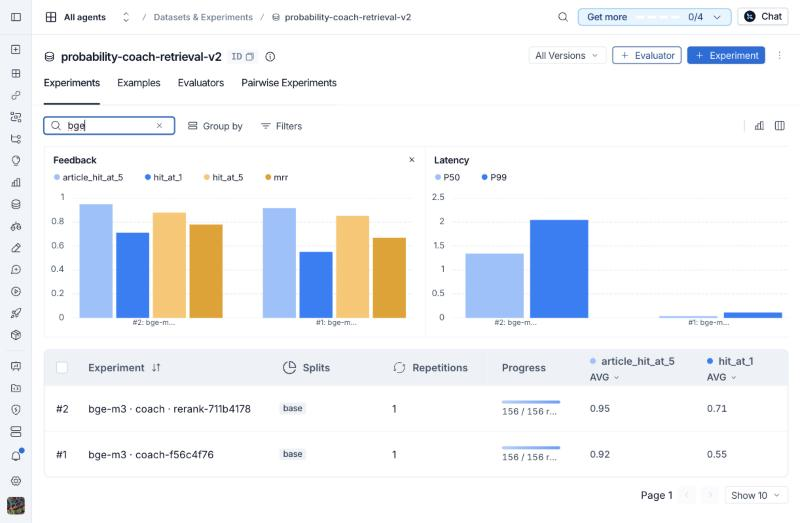
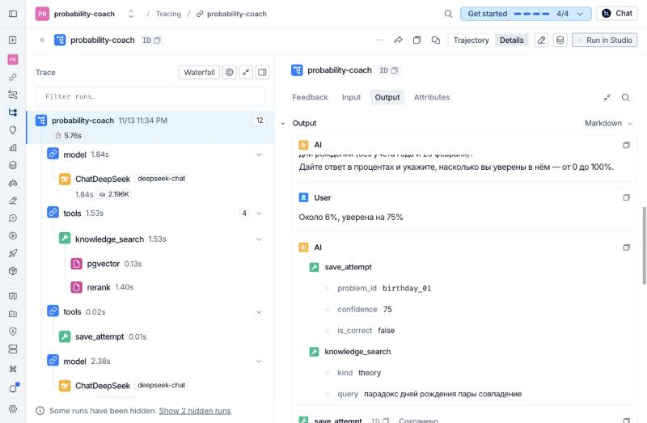
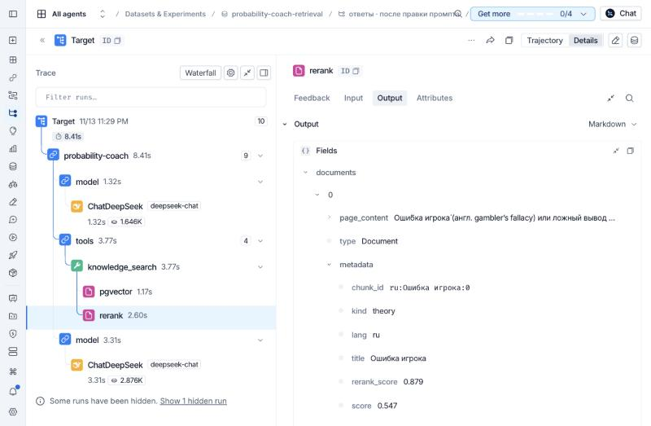

# Тренер вероятностной интуиции

Агент, который тренирует интуицию в вероятностях. Он даёт задачи, в которых люди систематически ошибаются
(Монти Холл, базовая частота, Линда, ошибка игрока, парадокс дней рождения и ещё пять типов ловушек),
спрашивает ответ и уверенность, объясняет ошибку по статьям Википедии из векторной базы, показывает
симуляцию и считает, насколько уверенность совпадает с точностью. Работает в браузере и в терминале.

Итоговый проект по курсу, агент с инструментами и векторным поиском.

LangChain 1.x / LangGraph, DeepSeek, Postgres + pgvector, bge-m3 + bge-reranker-v2-m3, LangSmith, Streamlit.

## Как устроено



| инструмент | что делает |
|---|---|
| `knowledge_search` | поиск по статьям (`kind="theory"`) или по банку задач (`kind="problem"`); задачи можно ограничить типом ловушки, решённые не повторяются |
| `simulate` | симуляция или разбор задачи в натуральных частотах с графиком, восемь видов (таблица ниже) |
| `save_attempt` | записывает, верен ли ответ и с какой уверенностью он дан |
| `my_stats` | точность по ловушкам, средняя уверенность, калибровка по группам уверенности, Brier score |

Поиск идёт в два шага: pgvector отдаёт 20 ближайших чанков, cross-encoder `bge-reranker-v2-m3`
пересортировывает их и оставляет лучшие. Статьи ищутся сразу по двум запросам, по формулировке агента и по
последней реплике пользователя. Векторы, история диалогов и статистика попыток хранятся в одном Postgres.
Модель выбирает инструмент по его описанию. Каждый вызов инструмента и каждый найденный чанк пишутся в лог.

## Симуляции

Каждый график разбивает случаи так, чтобы из разбивки следовал ответ. Симуляция есть у 31 задачи из 50,
её параметры записаны в банке задач, и агент берёт их оттуда.

| симуляция | ловушка | что на графике |
|---|---|---|
| `monty_hall` | Монти Холл | 10 000 игр, разделённых по первому выбору (автомобиль или коза), и доля выигрышей при смене двери и без неё |
| `base_rate` | базовая частота | дерево натуральных частот: сколько людей больны, у скольких тест положительный и какая доля из них больна |
| `birthday` | дни рождения | вероятность совпадения у любой пары и с вашим днём рождения в зависимости от размера группы, число пар |
| `gamblers_fallacy` | ошибка игрока | доля того же исхода после серии длиной 1…k на миллионе бросков |
| `small_samples` | малые выборки | распределение доли в выборках разного размера, крайние значения выделены цветом |
| `regression_to_mean` | регрессия к среднему | средний результат лучших и худших по первой попытке и их же во второй, между попытками ничего не меняется |
| `two_children` | условная вероятность | 100 000 семей с двумя детьми, разбитые по полу детей; семьи, которые исключает условие, заштрихованы |
| `simpson` | парадокс Симпсона | доля успехов по подгруппам и в сумме с числом случаев в каждой |



## Запуск

```bash
uv sync
cp .env.example .env              # вписать DEEPSEEK_API_KEY, для трейсинга — LANGSMITH_API_KEY
git config core.hooksPath .githooks
docker compose up -d              # Postgres + pgvector на localhost:5433
uv run python -m coach.ingest     # статьи и задачи -> векторная БД
uv run streamlit run src/coach/web.py   # веб-интерфейс на http://localhost:8501
uv run python -m coach.cli        # или чат в терминале
```

При первом запуске скачиваются bge-m3 и reranker, около 4 ГБ вместе. В браузере номер диалога хранится в адресе
(`?thread=...`), поэтому после перезагрузки страницы разговор остаётся на месте. Под каждым ответом одной строкой
перечислены вызванные инструменты с аргументами, а в раскрывающемся списке «Источники» лежат найденные фрагменты
статей. В боковой панели статистика пользователя и график калибровки: ответы сгруппированы по уверенности
(0–20%, …, 80–100%), и для каждой группы видна доля верных. В терминале `--thread <id>` продолжает прошлый
диалог, `--user <имя>` задаёт, чью статистику вести. Лог пишется в `logs/agent.log`. Тесты запускаются
командой `uv run pytest`, для части тестов нужен запущенный Postgres.





## Пример

Фрагмент реального диалога, ответы сокращены. Строки `TOOL` и `CHUNK` — лог агента.

```
вы> Дай задачу про двери и ведущего
TOOL knowledge_search {"query": "двери ведущий знает ответ", "kind": "problem", "trap": "monty_hall"}
CHUNK monty_hall_05 score=0.626 rerank=0.988
CHUNK monty_hall_01 score=0.622 rerank=0.985

тренер> Дверей четыре, за одной автомобиль. Вы выбираете одну. Ведущий, который знает, где автомобиль,
открывает две из трёх оставшихся дверей — за обеими козы. Менять ли выбор и с какой вероятностью вы
выиграете при смене? [...] И укажите уверенность в процентах.

вы> Думаю, без разницы, шансы 50 на 50. Уверенность 85%
TOOL knowledge_search {"query": "Монти Холл условная вероятность ведущий знает где автомобиль", "kind": "theory"}
TOOL save_attempt {"problem_id": "monty_hall_05", "is_correct": false, "confidence": 85}
CHUNK ru:Парадокс Монти Холла:1 score=0.657 rerank=0.983
CHUNK ru:Парадокс Монти Холла:8 score=0.694 rerank=0.983
CHUNK en:Monty Hall problem:12 score=0.608 rerank=0.903
CHUNK ru:Парадокс Монти Холла:3 score=0.639 rerank=0.861

тренер> Неверно. Правильный ответ: менять стоит, при смене вы выигрываете с вероятностью 3/4, без смены — 1/4.
[...] Ключевая мысль из статьи «Парадокс Монти Холла» (Википедия): [...] «изначально все двери имели
равные шансы быть выигрышными, но затем имели разные вероятности быть исключёнными». [...]

вы> Не верю, покажите
TOOL simulate {"name": "monty_hall", "params": {"n_doors": 4, "host_knows": true}}

тренер> Из 10 000 игр автомобиль оказался за вашей первой дверью в 2588 случаях — это примерно четверть [...]
В остальных 7412 играх автомобиль был за одной из трёх других дверей. Ведущий, зная, где он, открывает
две козы и оставляет закрытой именно дверь с автомобилем — поэтому смена выигрывает во всех этих случаях. [...]

вы> Как у меня с калибровкой?
TOOL my_stats {}

тренер> [...] Средняя уверенность 85%, доля верных ответов 0%. [...] Brier score 0.723 — очень высокий
(0 — идеальная калибровка, 0.25 — уровень «всегда отвечаю 50 на 50»). [...]
```



## Оценка

Оценок четыре: поиск, выбор инструмента, ответы агента и поведение в диалогах. Первые три написаны на
`langsmith.evaluate`, их вопросы и реплики лежат в `evaluation/` и загружаются в LangSmith как датасеты.
Проверка диалогов запускается локально.

### Поиск

```bash
uv run python evaluation/make_dataset.py         # вопросы -> evaluation/retrieval_questions.json
uv run python evaluation/retrieval.py            # bge-m3
uv run python evaluation/retrieval.py --rerank   # bge-m3 + reranker

export EMBEDDING_MODEL=intfloat/multilingual-e5-base
uv run python -m coach.ingest --collection coach_e5
uv run python -m coach.ingest --chunk-size 500 --collection coach_e5_500
uv run python evaluation/retrieval.py --collection coach_e5
uv run python evaluation/retrieval.py --collection coach_e5_500
uv run python evaluation/compare.py "<эксперимент A>" "<эксперимент B>"   # парное сравнение по тем же вопросам
```

Датасет `probability-coach-retrieval-v2` ([evaluation/retrieval_questions.json](evaluation/retrieval_questions.json))
содержит 156 вопросов на русском. Из каждой из 86 статей взяты два случайных чанка длиной от 400 символов,
всего 169. DeepSeek придумывал к чанку вопрос и выписывал из чанка опорную фразу с ответом, 4–10 слов подряд.
Восемь вопросов отброшены автоматически, потому что опорной фразы в чанке нет или она короче четырёх слов.
Ещё пять убраны вручную. Два из них о списке литературы, два без контекста не понять («какая доля участников
выбирала лотерею C во второй игре?»), в одном есть слово «фрагмент». 93 вопроса относятся к английским статьям,
63 к русским, вопросы есть к 85 статьям из 86.



Релевантным считается чанк, в котором есть опорная фраза, поэтому разметка не зависит от нарезки на чанки.

| метрика | что считает |
|---|---|
| Hit@1 | доля вопросов, где релевантный чанк найден первым |
| Hit@5 | доля вопросов, где релевантный чанк есть среди пяти найденных |
| MRR | среднее 1/r, где r — позиция релевантного чанка в пятёрке (0, если его там нет) |
| статья в top-5 | доля вопросов, где среди пяти найденных есть чанк из нужной статьи |

В скобках 95% доверительный интервал: бутстреп по вопросам, 2000 повторов.

| поиск | Hit@1 | Hit@5 | MRR | статья в top-5 |
|---|---|---|---|---|
| multilingual-e5-base, чанки 1000 | 0.36 (0.28–0.44) | 0.51 (0.43–0.58) | 0.41 (0.34–0.48) | 0.56 (0.48–0.63) |
| multilingual-e5-base, чанки 500 | 0.23 (0.17–0.30) | 0.46 (0.38–0.54) | 0.31 (0.25–0.38) | 0.56 (0.48–0.63) |
| bge-m3, чанки 1000 | 0.55 (0.47–0.63) | 0.85 (0.79–0.90) | 0.67 (0.61–0.73) | 0.92 (0.87–0.96) |
| bge-m3 + bge-reranker-v2-m3 | 0.71 (0.63–0.78) | 0.88 (0.83–0.92) | 0.78 (0.72–0.83) | 0.95 (0.91–0.98) |

| по языку статьи | e5-base, 1000 | bge-m3 | bge-m3 + reranker |
|---|---|---|---|
| Hit@5, русские статьи (63 вопроса) | 0.92 | 0.90 | 0.89 |
| Hit@5, английские статьи (93 вопроса) | 0.23 | 0.82 | 0.87 |
| Hit@1, русские статьи | 0.67 | 0.63 | 0.81 |
| Hit@1, английские статьи | 0.15 | 0.49 | 0.65 |

Больше всего на результат влияет модель эмбеддингов. Вопросы задаются по-русски, и e5-base находит русские
статьи (Hit@5 0.92), а английские почти нет (0.23). У bge-m3 разница между языками меньше: 0.90 и 0.82.

Reranker в основном переставляет найденное. Сравнение с bge-m3 без него сделано парным бутстрепом по тем же
156 вопросам (`evaluation/compare.py`): Hit@1 выше на 0.16 (95% ДИ 0.08–0.24, лучше на 35 вопросах, хуже
на 10), MRR выше на 0.11 (0.06–0.16). Разница по Hit@5 +0.03 (−0.02…+0.07) в пределах шума, потому что
reranker выбирает из тех же 20 кандидатов, которые отдал pgvector.

У e5-base чанки по 500 символов дают Hit@1 ниже, чем по 1000 (0.23 и 0.36), по Hit@5 интервалы перекрываются.



### Выбор инструмента

```bash
uv run python evaluation/routing.py
```

Датасет `probability-coach-routing-v2` ([evaluation/routing_cases.json](evaluation/routing_cases.json)) содержит
48 реплик. Если реплика отвечает на задачу, перед ней подставляется история, где агент эту задачу показал.
Проверяется, какой инструмент модель вызывает первым и с какими аргументами (`kind`, `trap`, имя симуляции,
`problem_id`, `is_correct`). Модель отвечает с температурой 0.3, поэтому каждая реплика прогоняется три раза,
всего 144 решения.

32 реплики однозначные:

| ожидаемый инструмент | реплик | пример |
|---|---|---|
| `knowledge_search`, задача | 8 | «Потренируй меня на регрессии к среднему» |
| `knowledge_search`, теория | 8 | «Чем чувствительность теста отличается от специфичности?» |
| `simulate` | 5 | «Проверь симуляцией, что после 7 орлов подряд решка не вероятнее» |
| `my_stats` | 4 | «Я слишком самоуверенна?» |
| `save_attempt` | 4 | «Мяч стоит 50 рублей, уверенность 95%» после задачи про биту и мяч |
| без инструмента | 3 | «Сколько будет 17 умножить на 3?» |

Ещё 16 реплик трудные. В них задача названа описанием, вопрос по теории похож на задачу, в ответе нет
уверенности или она названа словами.

| реплика | ожидается | верно из 3 |
|---|---|---|
| «Хочу задачу про Линду» | задача, `trap="conjunction"` | 3 |
| «Есть что-нибудь про больницы и долю мальчиков?» | задача, `trap="small_samples"` | 3 |
| «Дай задачку вроде той, про кувшинки на озере» | задача, `trap="crt"` | 3 |
| «Дай задачу, где путают вероятность «A при условии B» и «B при условии A»» | задача | 3 |
| «Дай задачу, но сначала коротко объясни, что такое регрессия к среднему» | `knowledge_search` | 3 |
| «Какова вероятность, что у двоих из 23 человек совпадут дни рождения?» | теория | 3 |
| «Что такое Brier score и почему 0,25 считается плохим результатом?» | теория | 3 |
| «Какой у меня сейчас Brier score?» | `my_stats` | 3 |
| «Сколько задач я уже решила?» | `my_stats` | 3 |
| «Смоделируй: в больнице рождается 15 или 45 детей в день, как часто мальчиков больше 60%?» | `simulate`, `small_samples` | 3 |
| «Покажи на графике, что после трёх промахов подряд шанс попасть не меняется» | `simulate`, `gamblers_fallacy` | 3 |
| «Думаю, менять не надо» после задачи Монти Холла | без инструмента: спросить уверенность | 3 |
| «Наверное, 1/3. Уверена процентов на шестьдесят» после задачи о двух детях | `save_attempt`, верно | 3 |
| «Примерно 10%, уверенность 50» после задачи о тесте на болезнь | `save_attempt`, верно | 3 |
| «Это же 50 на 50? Ставлю 90%» после задачи Монти Холла | `save_attempt`, неверно | 3 |
| «Не знаю. Скажи ответ» после задачи о кувшинках | `save_attempt`, неверно | 3 |

Инструмент выбран верно во всех 144 решениях, аргументы в 111 из 111 (аргументы проверяются у 37 реплик).

### Ответы агента

```bash
uv run python evaluation/answers.py
```

Агент отвечает на те же 156 вопросов, а DeepSeek с температурой 0 в роли судьи читает вопрос, фрагменты,
которые нашёл агент, опорную фразу и ответ.

| метрика | что считает |
|---|---|
| used_search | агент обратился к базе знаний |
| anchor_found | среди фрагментов, которые нашёл агент, есть чанк с опорной фразой; считается без судьи |
| faithfulness | доля утверждений ответа, которые подтверждаются найденными фрагментами, по оценке судьи |
| correctness | ответ передаёт то же, что опорная фраза: 1 — да, 0.5 — частично, 0 — нет |

| метрика | значение (95% ДИ) |
|---|---|
| used_search | 1.00 |
| anchor_found | 0.83 (0.76–0.88) |
| faithfulness | 0.94 (0.92–0.96) |
| correctness | 0.90 (0.86–0.93) |

| вопросы | сколько | faithfulness | correctness |
|---|---|---|---|
| нужный фрагмент среди найденных | 129 | 0.95 | 0.96 |
| нужного фрагмента среди найденных нет | 27 | 0.90 | 0.62 |
| к русским статьям | 63 | 0.93 | 0.90 |
| к английским статьям | 93 | 0.95 | 0.90 |

По correctness судья поставил 1 в 129 ответах, 0.5 в 23, 0 в трёх, ещё в одном 0.2 вместо одного из трёх
допустимых значений. Faithfulness равна 1 в 107 ответах, от 0.8 до 1 в 35, ниже 0.8 в 14.

Правильность ответа сильнее всего зависит от поиска. Если среди найденных агентом фрагментов есть нужный,
ответ верен в 0.96 случаев, если нет, в 0.62. Варианты поиска сравнивались отдельным прогоном на тех же
156 вопросах, запрос агента брался из первого шага модели:

| как искать статьи | Hit@4 |
|---|---|
| только по запросу агента | 0.63 |
| только по вопросу пользователя | 0.86 |
| кандидаты по обоим, reranker по склейке вопроса и запроса | 0.81 |
| кандидаты по обоим, каждый оценён тем запросом, который его нашёл | 0.83 |

В агенте стоит последний вариант. Поиск только по вопросу здесь сильнее, но вопросы датасета составлены по
тексту чанков, а в диалоге последняя реплика часто выглядит как «50 на 50, уверенность 85%», и по ней ничего
не найти. Когда каждый кандидат оценивается своим запросом, такая реплика не меняет оценок фрагментов,
найденных по запросу агента. По сравнению с поиском только по запросу агента Hit@4 выше на 0.20 (95% ДИ
0.13–0.26), лучше на 32 вопросах, хуже на одном. Из-за второго прохода reranker поиск занимает около
2,5 секунды на CPU.

Самые низкие оценки получили ответы, где агент достраивает рассуждение сам:

- «Можно ли подобрать такой масштабирующий множитель, чтобы распределение первой значащей цифры сколь угодно
  близко приблизилось к закону Бенфорда?» Агент добавил свой вывод о сдвиге логарифма, которого во фрагментах
  нет (faithfulness 0.4, correctness 0.5).
- «Какова вероятность того, что ты единственный ребёнок моряка и монета выпала орлом…?» Во фрагменте задача
  только поставлена, ответ 1/2 агент посчитал сам (0.5 и 0.5).

### Поведение в диалогах

```bash
uv run python evaluation/dialogs.py
```

Три диалога проверяют правила 3, 4, 7 и 9 из промпта (`agent.py`), каждый прогоняется 10 раз. Скрипт смотрит,
какие инструменты агент вызвал в последнем ходе и что написал.

| проверка | прошло |
|---|---|
| после неверного ответа и просьбы о симуляции агент ищет теорию | 10 из 10 |
| без поиска теории агент не называет источник | 10 из 10 |
| ответ без уверенности не сохраняется | 10 из 10 |
| вопрос, похожий на задачу, ищется в теории | 10 из 10 |

Кроме правила 4, о поиске теории после неверного ответа напоминает и результат `save_attempt`.

## Трейсинг

С `LANGSMITH_TRACING=true` каждый запрос попадает в проект `probability-coach` в LangSmith. В трейсе видны
вызовы модели, инструменты с аргументами и шаги поиска `pgvector` и `rerank` (тип `retriever`) с найденными
чанками, их источником и оценками. Диалоги группируются по `thread_id`.





## Ограничения

- Банк содержит 50 задач, по пять на ловушку. Решённые задачи не повторяются, поэтому после 50 попыток новые задачи кончаются.
- Верность ответа пользователя оценивает модель, сравнивая его с эталоном из банка.
- Вопросы для оценки поиска и ответов модель составляла по самим чанкам. Они ближе к тексту статей, чем вопросы
  живых пользователей, так что на реальных вопросах метрики поиска, скорее всего, ниже.
- Ответы оценивает та же модель, что отвечает. Ручной проверки оценок судьи нет.
- Веб-интерфейс локальный и без авторизации. Пользователь задаётся полем в боковой панели.

## Структура

```
src/coach/
  agent.py        промпт, агент, логирование вызовов инструментов
  web.py          веб-интерфейс на Streamlit
  cli.py          чат в терминале
  tools.py        инструменты агента
  search.py       поиск в pgvector и reranker
  simulations.py  симуляции с графиками
  stats.py        попытки и калибровка в Postgres
  ingest.py       загрузка статей и задач в векторную БД
  store.py        эмбеддинги и подключение к pgvector
evaluation/       датасеты и оценки поиска, выбора инструмента, ответов и диалогов
data/             список статей, их тексты, банк задач
tests/
```

## Данные

- `data/raw/` — тексты статей Википедии из `data/wiki_titles.txt` (CC BY-SA 4.0), сохранены локально,
  чтобы корпус и тестовый датасет не менялись вместе с Википедией.
- `data/problems.json` — 50 задач на 10 типов ловушек, по пять на каждый. Ответы проверены расчётом или симуляцией.
